<p align="center">
  <picture>
    <source media="(prefers-color-scheme: dark)" srcset="assets/readme/hero_dark.svg">
    
  </picture>
</p>

<h1 align="center">Camera Capture</h1>

A product photography app. The camera stands on a tripod, connected over USB, and the operator presses
<kbd>Enter</kbd>. The photo gets a white background, the product lands in the centre of the frame, a logo appears in
the corner, and the finished 3000 × 3000 JPEG goes to the session in the API.

## Result

The same products straight from the camera and after processing in the app, with no manual retouching.

<table>
  <tr><th width="50%">Straight from the camera</th><th width="50%">After processing</th></tr>
  <tr>
    <td>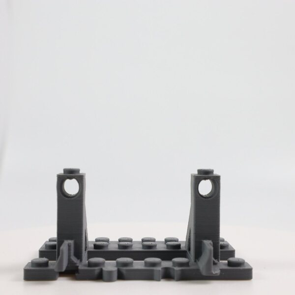</td>
    <td>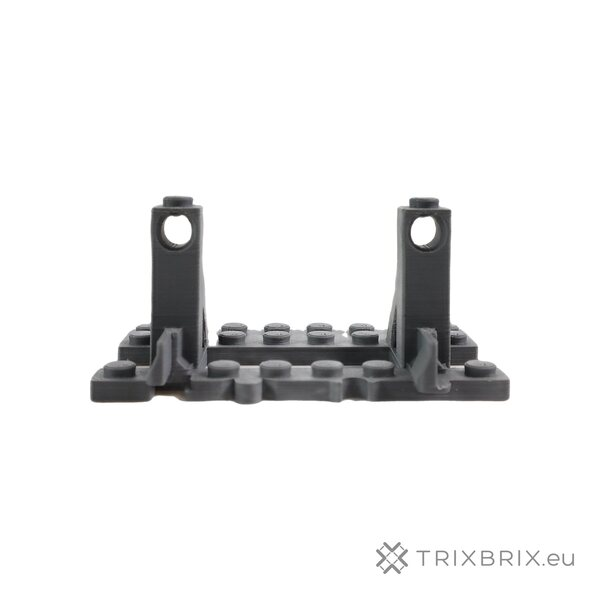</td>
  </tr>
  <tr>
    <td>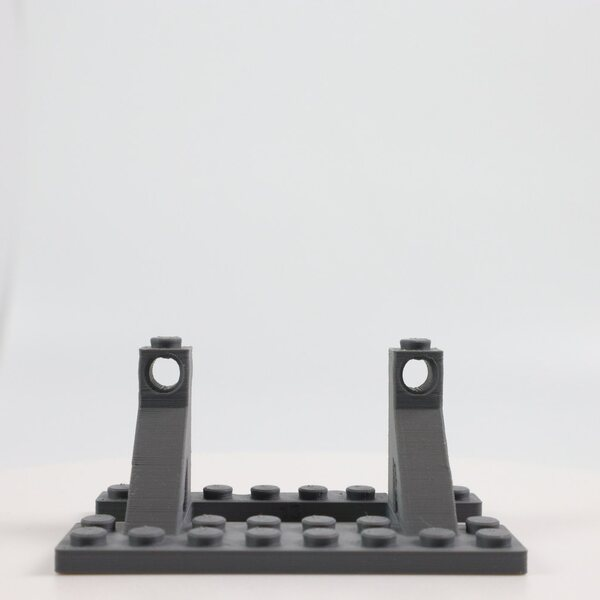</td>
    <td>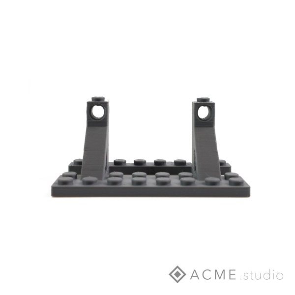</td>
  </tr>
  <tr>
    <td>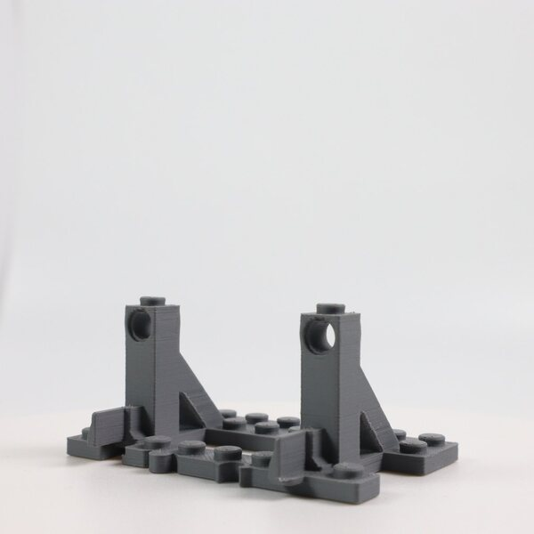</td>
    <td>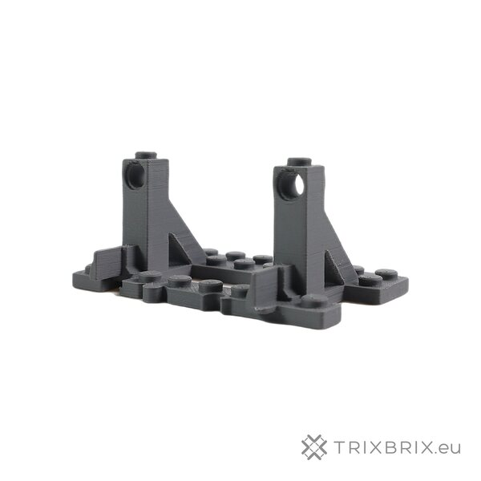</td>
  </tr>
</table>

## How it works

1. **The shot.** The app fires the shutter itself and downloads the file over USB through Canon EDSDK, on
   Windows and on macOS. There is no vendor program in between and no watched folder.
2. **Processing**, each step switchable in the post-processing panel:
   - **White background:** the background is pushed to pure white and the shadows under the product fade out.
   - **Zoom and centring:** the frame closes in on the product and puts it in the centre instead of wherever
     it happened to land on the table. A photo taken at an angle stays at that angle: nothing is straightened
     (apart from the small correction to the photo overlay, see [Photo overlay](#photo-overlay-and-alignment)).
   - **Logo:** one of two logo variants (or none), in the chosen corner of the frame. The README images use
     a sample "ACME.studio" logo.
3. **Saving and upload.** The finished file is stored in `photos/<session>/` with the raw camera original
   next to it, and the processed photo goes to the session in the API. The raw original stays on disk only.

One photo takes a few seconds from the shutter to the file on disk. Between shots, turn the product and press
<kbd>Enter</kbd> again.

## The app

The app is available in Polish and English: switch in Settings → Language, it changes immediately and
the choice is saved. The screenshots below show the Polish version.

### Session list

The start screen shows every session from the API, grouped by day, with a cover, the matched product and
the number of photos. A new session starts at the top: type the product name and press <kbd>Enter</kbd>. The list can be
searched and narrowed to a day, week or month and to a number of photos, and the arrow keys move between tiles.

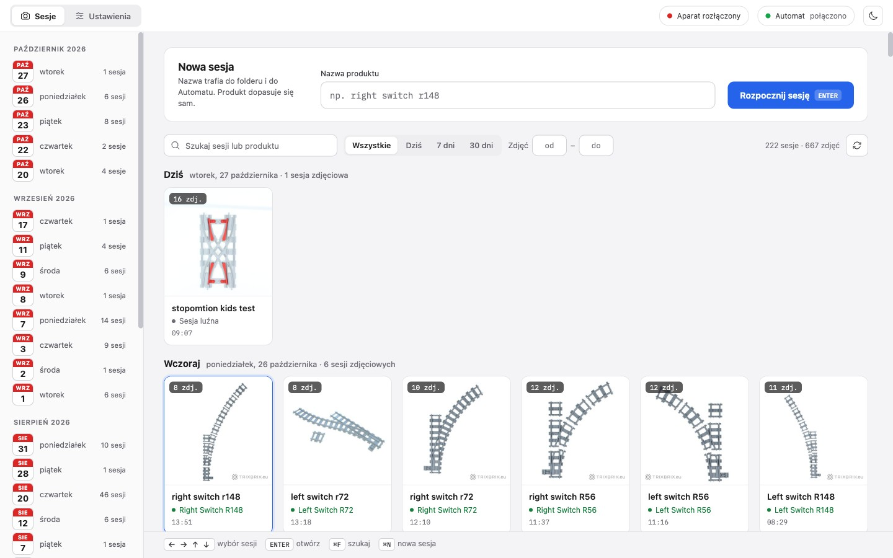

### Session

Live view from the camera with a framing grid like the camera's own (3×3 or 6×4) and a badge telling whether
the background is bright enough. At the bottom, the session's photo strip (green dot: the photo is already in
the API, orange: waiting to upload). Photos taken on another computer are downloaded from the API automatically.

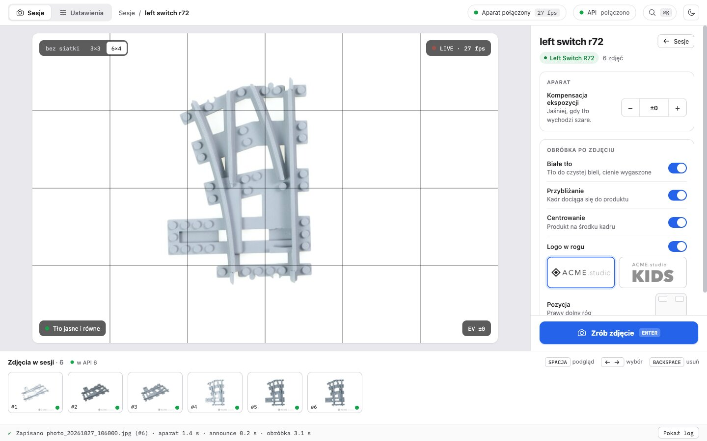
<sub>Captured with a stand-in camera: the photo overlay is on and the green frame says the next shot will be aligned to it.</sub>

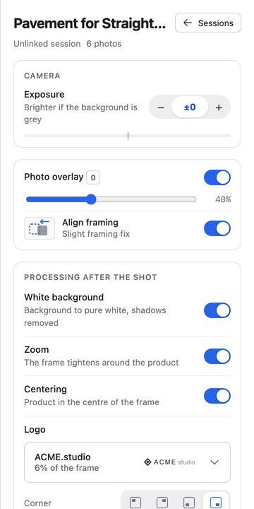

The side panel, top to bottom:

- **Exposure:** − and + change the camera's exposure compensation; the bar underneath shows how far it is
  from zero.
- **Photo overlay:** an earlier photo over the live view with an opacity slider, and **Align framing**
  (see below).
- **Processing after the shot:** white background, zoom and centring.
- **Logo:** a dropdown with your logos (or no logo), and the corner of the frame it goes in.

<br clear="right">

### Photo overlay and alignment

Shooting a series, every photo should have the product in exactly the same place, so that flipping through
them with the arrow keys nothing jumps. <kbd>O</kbd> lays the last photo over the live view, half transparent:
put the next product on top of it. The overlay stays on that photo; to use another one, open it
(<kbd>Space</kbd>) and press <kbd>O</kbd>.

With **Align framing** on, the app helps a little: when the product almost covers the overlay, the frame of
the finished photo is pulled onto it, by at most 2 % sideways, 3 % in size and 3° of rotation. A product placed
differently on purpose is left alone. Over the live view, the overlay's outline turns green ("aligning") when
the next shot will be corrected and stays grey ("too far") when it will not.

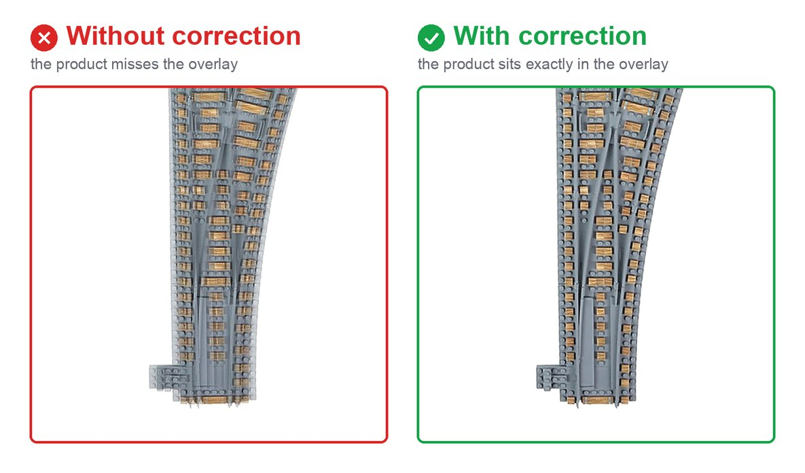

### Photo viewer and editing

<kbd>Space</kbd> opens a photo full window, the arrow keys move between photos, <kbd>Backspace</kbd> deletes (to the trash on disk
and from the API).

The panel on the right (<kbd>I</kbd> hides and shows it) has the photo's details: when it was taken and with
which camera, shutter speed, aperture, ISO and exposure compensation, lens, the size of the finished photo and
of the original, the author and copyright set in the camera, and what processing did (logo and its corner,
zoom, overlay alignment, upload to the API). The camera data is copied into the finished photo too (without
GPS or serial numbers), so it is there even when the original from `/raw` is gone.

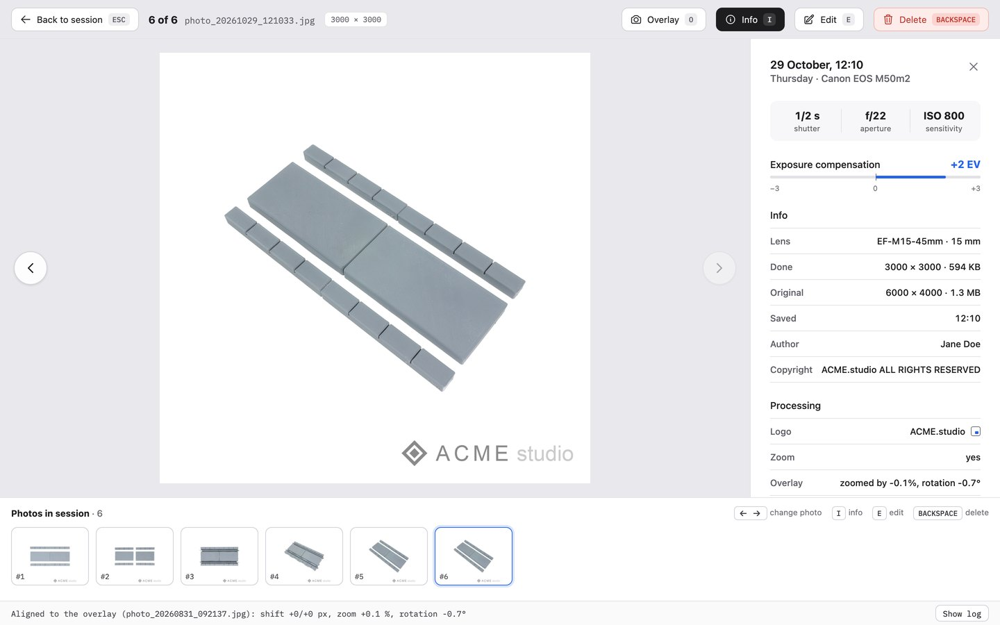

"Edit" (<kbd>E</kbd>) removes, adds or moves the logo on a finished photo; it opens next to the info panel.
The preview shows exactly what will be saved, and the change also replaces the same photo in the API.

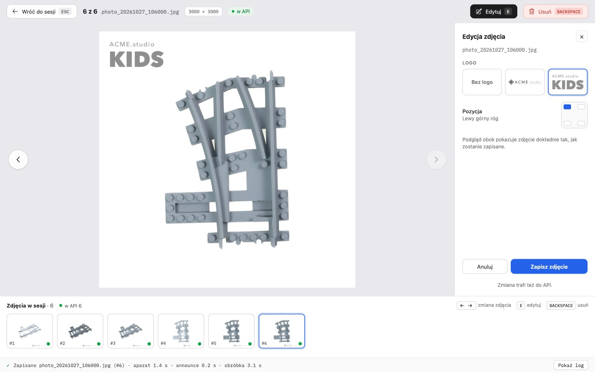

Editing works on photos that have a version without the logo: every photo taken with this app saves one.
Older ones are rebuilt from the camera original (`/raw`) if it was kept.

### Session menu and editing many photos

The session name in the top bar opens a menu: change the logo on the session's photos, show the session folder
on disk (Finder or Explorer), or go back to the session list.

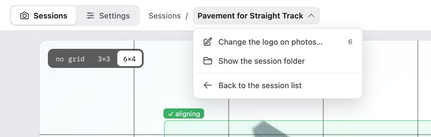

"Change the logo on photos…" opens all the session's photos at once. Select them like in Finder or Explorer:
click, <kbd>⌘</kbd>/<kbd>Ctrl</kbd>+click to add, <kbd>Shift</kbd>+click for a range, drag a rectangle,
<kbd>⌘</kbd>/<kbd>Ctrl</kbd>+<kbd>A</kbd> for all. Pick the logo and corner, and every selected photo gets it,
with progress on each tile. Photos without an original or a logo-free version are greyed out.

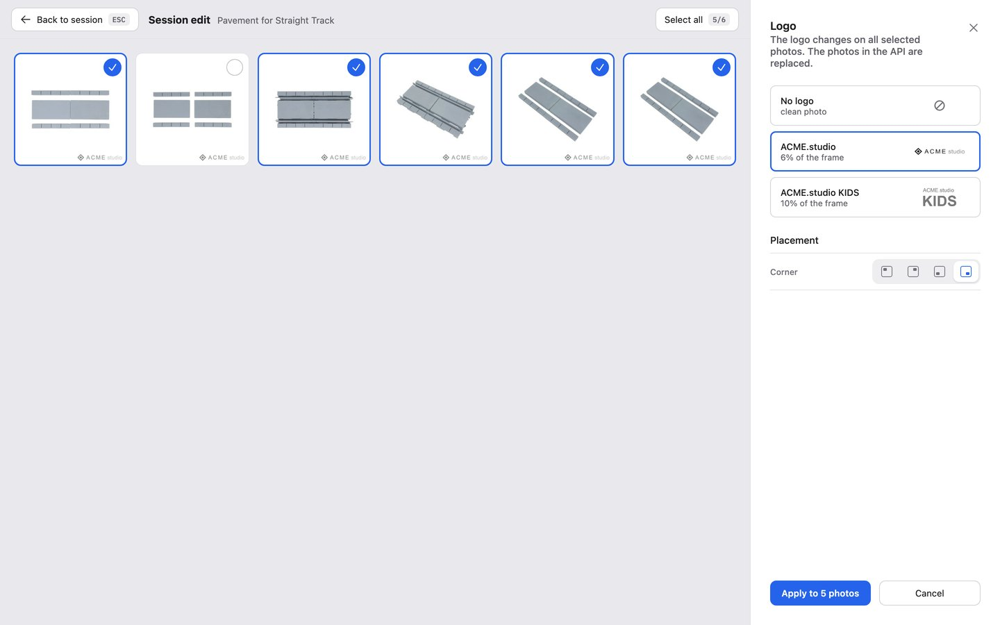

### Logos

The logos to choose from are managed in **Settings → Logo**: add a new one (PNG, SVG, WEBP or JPG; a
transparent background looks best), rename it, replace its file, or change its size (2-25 % of the frame
height) and opacity. The preview next to the form shows the logo on a mock-up of the finished photo, at
the same scale. Each logo needs a name of its own. The list and the files are kept next to `.env`, so they
survive updates.

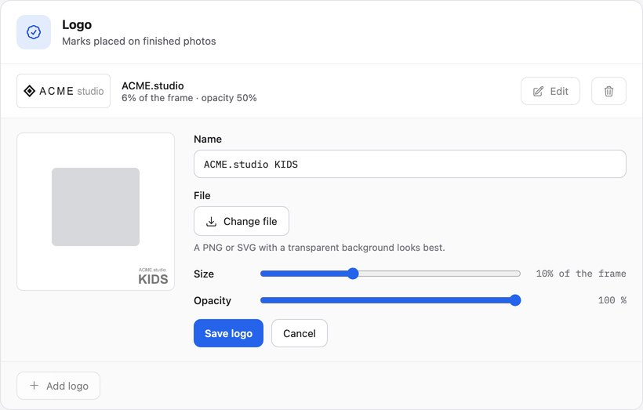

### Settings

Updates from GitHub Releases, the API connection (with the list of endpoints), logos (see above), files (including after how
many days camera originals are deleted), live view and processing, language (Polish or English) and keyboard
shortcuts. The light or dark
theme switches with the icon in the top right corner.

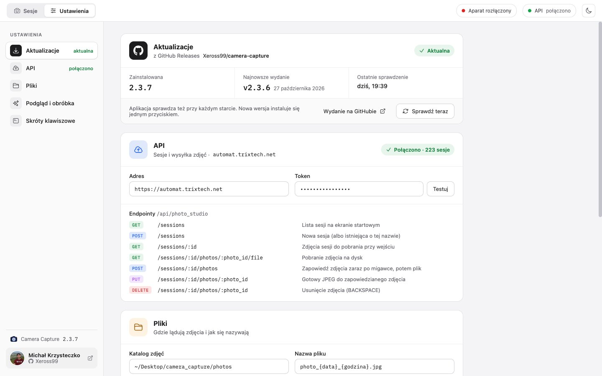

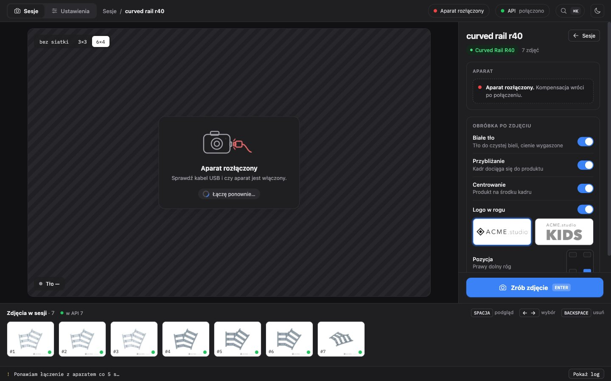

<sub>Dark theme. With the camera unplugged, an animated plug tries to connect in the preview frame and the app reconnects every few seconds.</sub>

### Keyboard

| Key | What it does |
|---|---|
| <kbd>Enter</kbd> | takes a photo (in the session list: opens the selected one) |
| <kbd>Space</kbd> | opens the photo viewer full window |
| <kbd>←</kbd> <kbd>→</kbd> | moves between photos |
| <kbd>E</kbd> | edits the logo on the photo being viewed |
| <kbd>I</kbd> | hides and shows the photo info panel in the viewer |
| <kbd>O</kbd> | turns the photo overlay on and off (in the viewer: lays the photo being viewed over the live view) |
| <kbd>Backspace</kbd> | deletes the photo: it goes to the trash on disk and disappears from the API |
| <kbd>Esc</kbd> | closes the viewer or leaves the session |
| <kbd>P</kbd> | turns the camera live view on and off |
| <kbd>⌘</kbd> <kbd>K</kbd> / <kbd>Ctrl</kbd> <kbd>K</kbd> | opens the session search from any screen |
| <kbd>⌘</kbd> <kbd>F</kbd> / <kbd>Ctrl</kbd> <kbd>F</kbd> | searches sessions in the session list |
| <kbd>⌘</kbd> <kbd>N</kbd> / <kbd>Ctrl</kbd> <kbd>N</kbd> | starts a new session |

## API

The app talks to the server through `/api/photo_studio` (address and token in Settings or in `.env`:
`AUTOMAT_URL`, `AUTOMAT_TOKEN`):

| Method | Endpoint | What for |
|---|---|---|
| `GET` | `/sessions` | session list on the start screen |
| `POST` | `/sessions` | new session (or the existing one with that name) |
| `GET` | `/sessions/:id` | the session's photos to download when it opens |
| `GET` | `/sessions/:id/photos/:photo_id/file` | download a photo to disk |
| `POST` | `/sessions/:id/photos` | announce a photo right after the shutter, then the file |
| `PUT` | `/sessions/:id/photos/:photo_id` | the finished JPEG for an announced photo |
| `DELETE` | `/sessions/:id/photos/:photo_id` | delete a photo (<kbd>Backspace</kbd>) |

## Installing on Windows

Windows 10 or 11 with the [WebView2 Runtime](https://developer.microsoft.com/microsoft-edge/webview2/)
(Windows 11 has it built in).

1. Download `CameraCapture-windows-vX.Y.Z.zip` from the latest Windows release and unzip it anywhere.
2. Put `EDSDK.dll` and `EdsImage.dll` (x64) from Canon EDSDK next to the `.exe`. They are not in the
   repository because Canon's licence does not allow it: download Canon EDSDK from Canon's developer
   programme (a free account).
3. Copy `.env.example` to `.env` and enter the API token (`AUTOMAT_TOKEN`). Photos go to `photos\` next to
   the `.exe`.
4. The `.exe` is not signed, so Windows SmartScreen may warn the first time: **More info → Run anyway**.

The first background cleanup downloads the background removal model (about 4.5 MB) to `%USERPROFILE%\.u2net\`,
so it needs internet access once.

## Installing on macOS

1. Download `CameraCapture-macos-vX.Y.Z.zip` from the latest macOS release (a Mac with Apple silicon, M1 or newer)
   and unzip it. You get a `Camera Capture` folder with `Camera Capture.app` inside.
2. Put `EDSDK.framework` from Canon EDSDK for macOS into that folder, next to `Camera Capture.app`.
3. Copy `.env.example` to `.env` and enter the API token (`AUTOMAT_TOKEN`). Photos go to `photos/` in the
   same folder.
4. The app is not signed by Apple, so the first time right-click it and choose **Open**, or remove the
   quarantine: `xattr -dr com.apple.quarantine "Camera Capture.app" EDSDK.framework`.

On macOS the app tells you a new version is out and its **Download for macOS** button opens the new
package. Unzip it in place of the old `Camera Capture.app`.

## Updates

The app checks for a newer version at start, and Settings can check on demand. One button downloads the
package, replaces the files and restarts the app. `.env`, `photos/` and the EDSDK files are left untouched.

A new version ships by itself: bump `APP_VERSION` in `src/version.py` and push to `main`. GitHub Actions
runs the tests, builds the Windows and macOS packages and publishes a separate release for each system
(`vX.Y.Z-windows` and `vX.Y.Z-macos`), where the app picks up its updates.

## Camera notes

- Exposure (ISO, aperture, shutter speed, white balance, AF mode) is set on the camera; the app changes only
  exposure compensation.
- The shot uses autofocus. If AF does not lock, the app says so: switch the lens to MF or fix the framing.
- Clicking the live view sets the focus at that point.
- Photos go straight to the app. If the camera does not hand the file over, after 8 seconds the app takes the
  newest photo from the memory card instead.

## Running from source

macOS:

```bash
python3 -m venv .venv
source .venv/bin/activate
pip install -r requirements.txt
python3 gui.py              # app window
python3 gui.py --browser    # the same in a browser
```

Windows (Python 3.11 or newer):

```bat
python -m venv .venv-win
.venv-win\Scripts\activate
pip install -r requirements-windows.txt
python gui.py
```

`requirements-windows.txt` swaps `onnxruntime` for `onnxruntime-directml`, so background removal runs on the
graphics card. Canon EDSDK sits in the project folder: `EDSDK.framework` on macOS (released from quarantine
with `xattr -dr com.apple.quarantine EDSDK.framework` if downloaded with a browser), `EDSDK.dll` and
`EdsImage.dll` on Windows.

Optional `.env` settings beyond `.env.example`: `EDSDK_DLL` (path to the SDK if it is not in the app folder)
and `CLEAN_BG_GPU=false` (background removal on the CPU, for machines with graphics driver trouble).

To build the Windows package by hand, run `build_windows.bat` on Windows: the result is
`dist\CameraCapture\`, to be moved as a whole. Releases do not need this, CI builds them.

## Tests

```bash
pip install -r requirements-dev.txt
python -m playwright install chromium
python -m pytest -q
```

The tests run without a camera (a fake one in `tests/conftest.py`) and without network access. CI runs them
on Windows and macOS before every build; if they fail, no new version is built.

## Documentation

Everything technical, such as how processing works, the photo queue, the camera connection, the updater and
the `.env` configuration, is described in [CLAUDE.md](CLAUDE.md) (in Polish).

## Author

<a href="https://github.com/Xeross99"></a>
**Michał Krzysteczko**<br>
[@Xeross99](https://github.com/Xeross99)
<br clear="left">

## License

All rights reserved. The code is published for viewing only; copying, changing or using it requires the
author's written permission. See [LICENSE](LICENSE).
